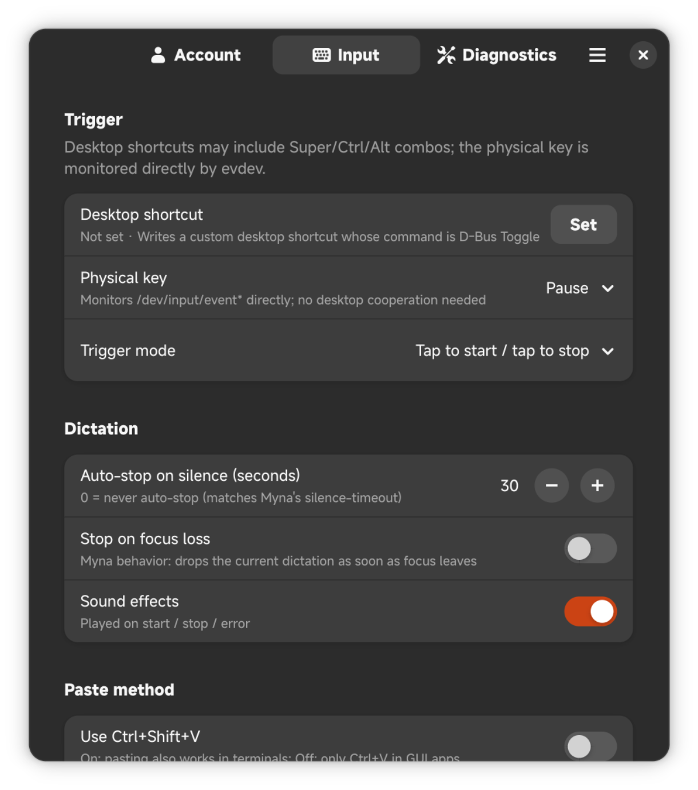

# Doubao Voice Input Method Myna UI Edition for Linux

<div align="center">

</div>

[简体中文](README.md)

---

## Project Overview
This project is a global voice input method developed based on the voice recognition capabilities of the Doubao Web version, specifically designed for native Wayland and GNOME desktop environments. It aims to resolve compatibility issues such as the failure of `xdotool` under Wayland and the dependency of `wtype` on the virtual-keyboard protocol (which Mutter has not implemented).

This project implements the Doubao reverse-engineering logic (including login, WebSocket ASR, and audio capture) and refactors the trigger, injection, and UI interaction mechanisms.

> This repository is a fork of [wurong98/doubao-input-for-linux](https://github.com/wurong98/doubao-input-for-linux): [Sam-Fic/doubao-myna](https://github.com/Sam-Fic/doubao-myna).
> The recognition and injection logic follows the Doubao scheme, while the UI layer is replaced with the icons, floating capsule renderer, and libadwaita settings window style from [Myna](https://github.com/canonical/myna). For detailed design, please refer to [`docs/design.md`](docs/design.md).

---

## Interface Showcase
**Control Window**
Application main panel (libadwaita three-page layout: Account / Input / Diagnostics). 

---

## Core Features
- **Interaction Modes**: Defaults to Push-to-Hold (press and hold to speak, release to input), triggered by the physical Right Ctrl key; can be switched to Myna's "press once to start / press again to end".
- **Configurable Shortcuts**: Supports writing custom desktop shortcuts (e.g., `<Super>j` combinations, commands go through D-Bus `Toggle`, consistent with Myna), and also supports directly specifying evdev physical keys; automatically ends after N seconds of silence.
- **Trigger Semantics Aligned with Myna**: Auto-end on silence (default 30 seconds, `0` to disable), provides a recoverable prompt of "No speech detected" for empty recognition results instead of silent failure.
- **Native Wayland Support**: Monitors key presses via `evdev` and simulates input via `uinput`, eliminating dependencies on X11/XWayland.
- **Chinese Input Optimization**: Uses clipboard writing combined with simulated Ctrl+V paste mechanism to avoid delays caused by keystroke-by-keystroke input.
- **Floating Status Window**: Fixed to use Myna's `myna-hud` (libadwaita + GPU waveform rendering, **source code already vendored in `vendor/`**). The interface only has this one appearance—the original self-drawn rounded rectangle floating window has been removed. The capsule **pins to the bottom center of the screen even without installing a GNOME extension** (layer-shell / XWayland self-hosted, automatically selected per session). If the renderer fails to start, status falls back to **desktop notifications**; dictation and paste functions remain unaffected.
- **Modern Settings Interface**: Built on libadwaita with a three-page PreferencesWindow (Account / Input / Diagnostics) using standard component libraries.
- **Multilingual Interface**: Source code language is English; Simplified / Traditional Chinese are supplemented via gettext translation files (`locale/zh_CN`, `locale/zh_TW`); the hamburger menu includes a "Language" submenu to switch at any time (selection saved to `settings.json`, persists after restart); copy for settings window, wizard, shortcut window, floating window, and desktop notifications is fully integrated.
- **Background Resident Operation**: The settings window "Input -> Startup" provides a **boot autostart switch** (background runs via `systemd --user` service; falls back to `~/.config/autostart` desktop entry on machines without systemd), supports single-instance operation and window invocation.
- **Local Credential Persistence**: Login status and credential files are stored in `~/.config/doubao-input/asr_params.json`, supporting cross-session reuse.
- **Rootless Operation**: Only requires adding the current user to the `input` group (automatically handled by the `.deb` installation script).

---

## System Requirements
| Component | Requirement Description |
|---|---|
| Operating System | Ubuntu 25.04 / GNOME 48 / Wayland (tested environment) |
| Python | 3.13 |
| Audio Service | PipeWire or PulseAudio |
| User Permissions | Current user must belong to the `input` group (to access `/dev/input/event*` and `/dev/uinput`) |
| GUI Dependencies | `gir1.2-adw-1` and `libadwaita-1-0` (automatically degrades to pure GTK4 window if missing) |
| Optional Dependencies | `cargo`, `libgtk-4-dev`, `libadwaita-1-dev` (only for compiling Myna's `myna-hud`); `libgtk4-layer-shell-dev` (Wayland native pin-to-bottom channel, automatically degrades to XWayland if missing) |

---

## Installation Guide

### Binary Package Installation (Recommended)
Download the `.deb` package from [`Releases`](https://github.com/wurong98/doubao-input-for-linux/releases), or execute `bash packaging/build-deb.sh` in the repository root directory to build.
```bash
# 1. Install the .deb package
sudo apt install ./doubao-input_1.0.2-1_all.deb
# Note: apt will automatically resolve dependencies. The postinst script will automatically add the current user to the input group and create a user-level venv to install PyPI dependencies.
# 2. Re-login to the system (to make the input group permissions take effect), then start
doubao-input
# Or turn on the "Boot Autostart" switch in the settings window "Input -> Startup" (command line equivalent:)
systemctl --user enable --now doubao-input.service
```

**System-level Dependency List** (automatically handled by `.deb`):
`python3-gi`, `gir1.2-gtk-4.0`, `gir1.2-adw-1`, `gir1.2-webkit-6.0`, `libgtk-4-1`, `libadwaita-1-0`, `libwebkitgtk-6.0-4`, `wl-clipboard`, `init-system-helpers`, `python3-pip`, `python3-venv`.

**Python Dependencies** (automatically installed by `postinst` to `~/.local/share/doubao-input/.venv`):
`websockets`, `sounddevice`, `evdev`.

> Note: You must re-login to the system after installation, otherwise `evdev` and `uinput` will fail to start the application due to insufficient permissions.

### Source Code Compilation Installation
```bash
git clone https://github.com/wurong98/doubao-input-for-linux.git
cd doubao-input
# 1. Install system dependencies
sudo apt install python3-gi gir1.2-gtk-4.0 gir1.2-adw-1 gir1.2-webkit-6.0 \
libgtk-4-1 libadwaita-1-0 libwebkitgtk-6.0-4 wl-clipboard
# 2. Configure user group (requires re-login to take effect)
sudo usermod -aG input $USER
# 3. Configure Python virtual environment
python3 -m venv .venv
.venv/bin/pip install -r requirements.txt
# 4. Start the application
./start.sh
```

### First-time Configuration
The first launch will pop up a **Settings Wizard** (aligned with Myna's onboarding): Welcome -> Login to Doubao (cannot continue without login) -> Set Shortcuts (desktop shortcuts, physical keys, trigger modes can all be changed directly here) -> Myna Floating Capsule (optional, with installation commands). The wizard only appears once, and can be reopened later via the settings window main menu "Run Setup Wizard...".

Complete the Doubao web login in the WebView, the built-in JS interceptor will automatically extract Cookies, `device_id`, and `web_id`, and write them to `~/.config/doubao-input/asr_params.json`. The login window will then close automatically.

**Operation Logic**:
- **Hold Right Ctrl**: Invoke the floating capsule, displaying recognized text in real-time.
- **Release Right Ctrl**: Wait for a 1-second timeout to receive the final result, write to the clipboard via `wl-copy`, and trigger `uinput` to simulate Ctrl+Shift+V paste into the current focused input box.
- **Press duration < 150ms**: Judged as an accidental touch, injection is canceled.
- **Press ESC during session**: Cancel and discard the current content.

---

## Interface Integration (Myna Scheme)
This project replaces the UI layer with the Myna scheme while retaining the original recognition and injection logic.

| UI Module | Implementation Scheme | Code Location |
|---|---|---|
| Settings/Control Window | libadwaita three-page layout (Account/Input/Diagnostics) | `ui/control_window.py` |
| Floating Status Capsule | Myna `myna-hud` (GTK4 + GPU waveform rendering) | `hud/` |

### Settings Window
Uses `Adw.ApplicationWindow` combined with `ToolbarView` and `HeaderBar`, internally managing three configuration pages via `Adw.ViewStack`. If libadwaita is missing in the system, it automatically degrades to a pure GTK4 window.

Interface components try to delegate to libadwaita's default values as much as possible to reduce manual styling:

| Detail | Implementation |
|---|---|
| Login Prompt | Top `Adw.Banner` (appears when not logged in, with a "Login" button), rather than just relying on a line of small text |
| Main Menu | `Gio.Menu` + `Gtk.MenuButton` (Run Wizard / About), with built-in keyboard navigation |
| Keycaps | `Adw.ShortcutLabel` (older libadwaita falls back to built-in `.keycap` style) |
| Buttons | Row-end small buttons are strictly **plain text** (GNOME settings convention: small buttons with icons add noise), only retaining `suggested-action` / `destructive-action` semantic colors |
| Status Information | Written on the "row subtitle", automatically wraps with window width, text uniformly escaped |
| Diagnostic Report | No nested borders inside cards (Adw anti-pattern), height capped and handed over to page scrolling, no double scrollbars |
| First-run Wizard | `Adw.Window` + `Adw.StatusPage` welcome page + "Previous / Next" on the title bar + `Adw.Toast` prompts |
| Shortcut Capture | `Adw.Window` + `Adw.StatusPage` (icon + prompt), Esc to cancel |

- **Account Page**: Manages login status, credential path (one-click copy), and re-login operations.
- **Input Page**: Desktop shortcuts (keycap display + key capture, Esc to cancel), evdev physical keys, trigger mode (hold / toggle), silence auto-end seconds, end on focus loss (optional switch), prompt sound switch, waveform style, paste shortcut (Ctrl+V / Ctrl+Shift+V), boot autostart, and floating window component selection.
- **Diagnostics Page**: Provides microphone self-test, clipboard link test, floating window status monitoring, recent error logs (with time), and a privacy-safe diagnostic report (refresh / copy; does not contain audio, recognized text, or file paths, paths uniformly replaced with `[redacted]`).

### Trigger Configuration (Aligned with Myna)
| Item | Myna | This Project |
|---|---|---|
| Shortcut Carrier | Desktop custom shortcuts (GNOME dconf / Xfce xfconf), command is `gdbus call … Dictation.Toggle` | Same (`trigger/desktop_shortcut.py`) |
| Available Keys | Must include Ctrl/Alt/Super, or function / media keys; bare letters not accepted | Same (key capture within settings window, Esc to cancel) |
| Physical Key Direct Connection | None | Extra support for evdev physical keys (default Right Ctrl, 12 options available) |
| Trigger Mode | Press once to start / press again to end | Two modes selectable, default remains hold-to-speak |
| Silence Auto-end | `silence-timeout`, default 30 seconds, `0` to disable | Same (0-600 seconds adjustable) |
| End on Focus Loss | Always on (IBus channel can perceive) | Set as **optional switch, default off** (see explanation below) |
| Empty Result | `notice` "No speech detected" | Same ("No speech detected") |

Persistence keys are located at `~/.config/doubao-input/settings.json`: `desktop_shortcut`, `trigger_key`, `trigger_mode`, `silence_timeout`, `hud_style`.

### Floating Capsule and D-Bus Integration
The floating capsule runs as an independent process and receives status updates via D-Bus properties.
- **Interface Definition**: `com.canonical.Myna.Dictation` (includes State, StatusMessage, AudioRms, AudioPeak, HudStyle).
- **State Mapping**:
  - `loading`: Connecting to WebSocket.
  - `recording`: Recording, displaying real-time recognized text or "Listening...".
  - `finalizing`: Waiting for final recognition result.
  - `error` / `notice`: Displaying error prompts or notifications.
  - `idle`: Hiding the capsule.
- **Data Push**: Audio level (RMS) is pushed at a 20Hz frequency and smoothed with interpolation.

#### Why Recognized Text Doesn't Stretch the Capsule Vertically (Single Line + Horizontal Scrolling)
When "Use Myna Floating Capsule" is turned on in settings, the text is drawn by the independent GTK4 process **`myna-hud`**. Its source code is **vendored in the `vendor/` directory of this repository** and can be modified at any time:
```
vendor/
├── myna-hud/          ← Capsule body (pill / waveform / D-Bus consumer)
├── myna-platform/     ← Desktop contract crate it depends on
├── build-support/     ← Version number generation
└── Cargo.toml         ← Independent workspace, no dependency on external checkout
```
Modifications for this project are written directly in the vendored source code: the capsule label is changed from "wrapping" to "**always one line + width capped + old text scrolls left**".

| | Upstream Behavior | This Project |
|---|---|---|
| Text gets longer | Wraps, capsule gets **taller** | Capsule gets **wider**, height remains unchanged |
| Width limit | None (`max_width_chars(30)` only constrains wrapping) | 420px (`LABEL_MAX_WIDTH`) |
| After exceeding | Squeezed into multiple lines | Old text slides left, newest text stops at the right end |

The upstream issue is that the unit of `label.set_max_width_chars(30)` is Pango's **average Western character width** (Sans 11pt ≈ 7.05px), the whole line is only about 211px; while a Chinese character takes 15px, it wraps at the 15th character.

Build (can run directly after installing `.deb`, no external source code needed):
```bash
bash scripts/build-myna-hud.sh      # Use source code in vendor/
```
To build the **unmodified** upstream version (capsule will wrap):
```bash
MYNA_SOURCE_DIR=/path/to/myna bash scripts/build-myna-hud.sh
```

This project side is only responsible for sending **a piece of text that just fits one screen**: `hud/wire.fit_tail` truncates to 58 units ≈ 420px ≈ 19 Chinese characters / 57 English characters based on display width (half-width narrow characters 1 unit, normal half-width 2, Chinese and full-width punctuation 3, all rounded up based on actual measurements). Longer parts cannot be displayed by the capsule anyway, keeping them would just waste 20Hz D-Bus bandwidth.

Effect (same sentence growing step by step):
```
Today at 3 PM we and the design team          ← Not full, aligned left
...and the design team have a meeting to discuss the new version      ← Overflow, earliest words are squeezed out
...a meeting to discuss the UI interaction details of the new version and
...interaction details and the scope of features to be delivered next quarter  ← Right end is always the latest spoken words
```

Self-check:
```bash
PYTHONPATH=src python3 tests/check_hud_width.py   # Text width budget
cd vendor && cargo run --release -p myna-hud --example scroll_check
# Capsule real layout behavior
```

### Capsule Placement: Bottom of Screen Without Extension (GNOME Extension is Optional Enhancement)
Ordinary windows in Wayland do not have a self-positioning API, and GNOME's mutter does not support the layer-shell protocol ([mutter#973](https://gitlab.gnome.org/GNOME/mutter/-/issues/973) has not been merged to date) — so the original Myna relies on a GNOME extension to position the window as an overlay. This project has built-in **extension-less self-hosted placement** in the vendored `myna-hud`, automatically selecting the channel according to session capabilities (`--anchor bottom`):

| Session | Channel | Effect |
|---|---|---|
| niri / sway / Hyprland / KDE, etc. | **layer-shell** (native Wayland overlay, Top layer) | Bottom center, 24px from top edge, no focus, click-through |
| GNOME (mutter, no layer-shell) | **X11 self-hosted** (XWayland) | Same bottom center; relies on mutter respecting X11 positioning and keep-above |
| X11 session | X11 self-hosted (`--host x11`, original channel) | Bottom center, avoiding panel dock |
| Neither available | No positioning (compositor places arbitrarily) | Maintains old behavior (roughly centered) |

The layer-shell channel requires `libgtk4-layer-shell` at compile time (runtime libraries are included in most distributions):
`sudo apt install libgtk4-layer-shell-dev` then re-run `bash scripts/build-myna-hud.sh` (the script will pkg-config probe `gtk4-layer-shell-0`, automatically degrades if not detected, build does not break).

The GNOME extension is still the **optimal** channel (picks "the monitor where the focused window is located", avoids dash-to-dock, auto-restarts on crash), install if desired:
```bash
# 1. Install extension (will automatically patch resolve.js: prioritize ~/.local/bin/myna-hud, bypass snap)
bash scripts/install-gnome-extension.sh
# 2. Log out and log back in once (GNOME Shell only reads ~/.local/share/gnome-shell/extensions at login)
#    After re-login, the extension is automatically enabled; can also be manually confirmed:
gnome-extensions enable myna-shell@canonical.com
```
Afterwards, the extension is responsible for pulling up `myna-hud` and placing the window at the bottom center of the "monitor with the currently focused window" (24px from the bottom edge of the workspace, avoiding panels and dash-to-dock, click-through, auto-restart on crash).

When this project detects the extension is enabled (`org.gnome.shell enabled-extensions`), it will no longer pull the process itself, avoiding two capsules; if the extension fails to pull the renderer within 5 seconds, it will pull one as a fallback (going through the same `--anchor bottom` channel).

The installation script will automatically configure the `MYNA_HUD_BINARY` environment variable, allowing the extension to directly call the locally compiled binary file without relying on Snap.

**Environment Compatibility and Troubleshooting**:
- With multiple monitors, the extension-less channel uses "the monitor where the pointer is located" (layer-shell uses GDK default output); the extension picks the focused monitor. No difference on a single screen.
- The extension-less channel only guarantees "24px above the bottom edge of the screen", it will not additionally avoid the bottom dock (the extension will).
- The GNOME/XWayland channel relies on mutter's support for X11 positioning and keep-above (high confidence but not tested version by version); if the capsule is still centered on GNOME, install the extension.
- If dual-process conflicts occur, please check the extension enablement status, or set `HUD_AUTO_LAUNCH` in `config.py` to `False`.

---

## Configuration Parameters
Core configuration file located at `src/doubao_input/doubao/config.py`:

| Constant | Default Value | Description |
|---|---|---|
| `HUD_ENABLED` | `True` | Whether to prioritize using Myna capsule (user settings stored in `settings.json`) |
| `HUD_AUTO_LAUNCH` | `True` | Whether to automatically pull up the `myna-hud` process |
| `HUD_STYLE` | `"ribbon"` | Waveform rendering style (bar / ribbon / vumeter / progress) |
| `HUD_SHOW_TRANSCRIPT` | `True` | Whether to display real-time recognized text in the capsule |
| `HUD_STATUS_MAX_CHARS` | `30` | Maximum number of characters for status text |
| `HUD_LEVEL_HZ` | `20` | Audio level push frequency |
| `INJECT_USE_SHIFT` | `True` | Whether to use Ctrl+Shift+V for pasting |
| `TRIGGER_KEY_NAME` | `"KEY_RIGHTCTRL"` | evdev physical key name |
| `TRIGGER_MODE` | `"hold"` | Trigger mode: `hold` (press and hold to speak) / `toggle` (Myna semantics) |
| `SILENCE_TIMEOUT_SECS` | `30` | Silence auto-end seconds, `0` to disable |
| `SOUNDS_ENABLED` | `True` | Play prompt sounds at start / end / error (system freedesktop event sounds) |
| `CANCEL_KEY_NAME` | `"KEY_ESC"` | Press this key during session to cancel and discard current content; set to empty string to disable cancel key |
| `STOP_ON_FOCUS_LOSS` | `False` | End and discard current content when focus leaves the target window (aligned with Myna), default off |
| `FOCUS_CONFIRM_TICKS` | `2` | How many consecutive times a focus change must be read to be confirmed (prevents X11/XWayland jitter false positives) |
| `DESKTOP_SHORTCUT` | `""` | Desktop custom shortcut, e.g., `"<Super>j"` |

> All above are default values; user selections in the settings window are saved in `~/.config/doubao-input/settings.json`.
> For item-by-item experience comparison with Myna (including unported items) see [`docs/myna-parity.md`](docs/myna-parity.md).

---

## Development Guide

### Project Structure
```text
src/doubao_input/
├── __main__.py            # Program entry
├── app.py                 # GtkApplication lifecycle management
├── autostart.py           # Boot autostart switch (systemd user unit / XDG autostart)
├── doubao/                # Doubao reverse-engineering core (ASR, audio capture, credential management)
├── trigger/evdev_ptt.py   # Physical key monitoring (evdev, keys configurable)
├── trigger/desktop_shortcut.py  # Desktop custom shortcuts (GNOME/Xfce, goes through D-Bus Toggle)
├── inject/injector.py     # Clipboard and uinput injection
├── hud/                   # Myna floating window D-Bus bridging and process management
└── ui/                    # GTK4/libadwaita interface implementation
```

### Probe Tests
The `tests/probe/` directory contains independent test scripts for verifying core link availability:
- `P5_login.py`: Verifies Doubao login and credential writing.
- `P6_asr.py`: Verifies WebSocket connection and ASR recognition.

### Log Debugging
Default log level is `INFO`, output to stderr:
```bash
./start.sh --verbose        # Or -v, prints DEBUG (evdev device scanning, D-Bus details, etc.)
./start.sh --quiet          # Only WARNING and above
./start.sh --show           # Invoke control window (.desktop show-control action)
./start.sh --log-file ~/doubao-input.log   # Also write to file
```

---

## Packaging and Release
The project provides `.deb` packaging scripts and systemd user service configuration based on the `debian/` directory.
```bash
# Build .deb package
bash packaging/build-deb.sh
# Install (after installing .deb, boot autostart is on by default, can be turned off in settings window "Input -> Startup")
sudo dpkg -i doubao-input_*.deb
# Command line equivalent for autostart switch
systemctl --user enable --now doubao-input.service
```

---

## Known Limitations
1. **Paste Shortcut Compatibility**: Defaults to Ctrl+Shift+V to be compatible with terminal environments, some GUI applications only support Ctrl+V, needs to be manually switched in the settings interface.
2. **Default Floating Window Positioning**: When the GNOME extension is not installed, `myna-hud` runs as an ordinary window, position is allocated by the compositor, unable to achieve native bottom center and anti-occlusion.
3. **System Tray Visibility**: The application exports a StatusNotifierItem tray (show control window / check microphone / exit), but GNOME does not display SNI by default, requires installing the AppIndicator extension:
`sudo apt install gnome-shell-extension-appindicator` (Ubuntu generally comes with `ubuntu-appindicators` built-in, no extra operation needed if enabled). Not installing it will not affect any functions—the tray is just one of the entrances, the settings window and `.desktop` entries are still available; the diagnostics page will clearly state the reason.
4. **Interface Stability**: Relies on Doubao Web version's non-public interfaces, if the official changes the API, it may lead to ASR failure.
5. **Clipboard Occupation**: The input process will overwrite the current content of the system clipboard.
6. **"End on Focus Loss" is best-effort**: Myna precisely perceives the target field through IBus, this project uses the clipboard and can only ask the desktop.
It can truly take effect in X11 sessions; under Wayland, third-party processes cannot read the focus of other windows (GNOME Shell's `Eval` is closed by default), this switch will be grayed out and the reason explained, even if usable, it is recommended to try it before enabling it long-term (built-in "confirm only after reading changes twice consecutively" debouncing).

---

## Security and Privacy Notes
- **Credential Storage**: Doubao login cookies are stored in `~/.config/doubao-input/asr_params.json`, file permissions 0600, configuration directory 0700, readable only by the current user. Plaintext JSON is still a compromise within the security boundary, those who mind can confirm the file is deleted after logging out (logging out will automatically delete it).
- **The Cost of the `input` User Group**: Rootless operation relies on adding the user to the `input` group, members of this group can read the event streams of **all** keyboards/mice on the system (which also means possessing keyboard sniffing capabilities). This is an inevitable requirement of the evdev scheme, please be aware before installing.
- **Recognized Text**: Recognition results are only written to the clipboard and simulated for pasting, the clipboard will be automatically cleared within 1.5 seconds after successful injection; logs only record text length, not content. But clipboard managers (like GPaste) may have saved the history before it is cleared, please evaluate by yourself for privacy-sensitive voice.
- **ASR Channel**: Audio goes directly to `ws-samantha.doubao.com` via WSS (TLS), no local proxy relay, no third-party reporting.

---

## Changelog
For complete records, please refer to [`debian/changelog`](debian/changelog).

### v1.1.1 (2026-10-25)
- **All interface copy is translatable**: v1.1.0 only migrated the main menu, most of the copy in the window was still hardcoded Chinese, switching languages had no effect. This version changes the settings window, first-run wizard, shortcut capture window, built-in floating window, and desktop notifications all to English source code + gettext directory, Simplified / Traditional Chinese now have 157 translated entries, covering all 142 interface strings.
- Fixed **physical key names having two tables and being out of sync**: `doubao/config.py` still had Chinese display names, `ui/control_window.py` had already been changed to English, causing inconsistencies between the settings page dropdown and startup prompts; now only keeping one copy in `config.py`.
- Added **boot autostart switch** (Input -> Startup): status directly reads the backend (`systemd --user` service or `~/.config/autostart`), does not save another cache; if writing fails (no systemd, directory not writable) it will flip the switch back and prompt the reason.
- Diagnostic report adds boot autostart status and used backend.
- Fixed the issue where the default prompt in the shortcut capture window was solidified before `i18n.init()`, causing translations to not take effect.

### v1.1.0 (2026-10-21)
- Refactored settings interface, adopting libadwaita three-page layout.
- Security hardening: credential file 0600 / configuration directory 0700; logs no longer contain recognized text; clipboard automatically cleared after successful injection; login WebView tightened; postinst dependencies added version upper bounds; systemd user service basic hardening (see "Security and Privacy Notes" for details).
- Integrated Myna `myna-hud` renderer and D-Bus status synchronization mechanism.
- Replaced application icon with Myna official SVG icon.
- Fixed GLib assertion warnings and `EvdevPtt` abnormal startup blocking caused by `myna-hud` abnormal termination.
- Unified preference settings storage to `~/.config/doubao-input/settings.json`.
- Added configurable triggers: desktop custom shortcuts (combinations), evdev physical key selection, Myna-style toggle trigger, silence auto-end.
- Empty recognition results changed to recoverable prompts (aligned with Myna's "No speech detected").
- Added desktop notification fallback: when capsule is unavailable, status goes to a single in-place replacement notification (copy does not contain recognized text).
- Added prompt sounds (start / end / error, goes through system event sounds) and ESC cancel.
- Added shortcut conflict detection (desktop reserved key prompts to change, custom key pops "Replace?") and recent error logs (diagnostics page + D-Bus `LastError*`).
- Command line supports `-v/--verbose`, `--quiet`, `--show` (the latter makes the `.desktop` show-control action truly effective).
- Built-in floating window follows system "reduce motion" settings.
- Added privacy diagnostic report (refresh / copy, aligned with Myna's "does not contain audio, recognized text, file paths" promise).
- Fixed: settings window would flash after each paste completion (unconditional hide+restore → changed to only hide when it actually grabs focus).
- Added first-run wizard (Welcome -> Login -> Shortcuts -> Myna Capsule) and settings window main menu (Run Wizard / About).
- Added `--log-file` file logging; built-in floating window supports high contrast.
- Added `docs/myna-parity.md`, itemizing the alignment with Myna experience design.
- UI detail polishing (components uniformly go through libadwaita defaults):
  - `Adw.Banner` appears at the top of the window when not logged in, can directly click "Login".
  - Main menu changed to `Gio.Menu` + `Gtk.MenuButton`; keycaps changed to `Adw.ShortcutLabel`; row-end buttons remove icons, keeping only text.
  - "Recent errors" and "floating window status" changed to be written on row subtitles (auto-wrap, text escaped).
  - Diagnostic report removes nested borders and double scrollbars; silence seconds changed to numeric `Adw.SpinRow`.
  - First-run wizard changed to `Adw.StatusPage` welcome page + title bar navigation + real Toast; shortcut capture window also uses Adw.
  - Built-in floating window changed to non-resizable, non-focus-grabbing, Chinese wraps by character.
  - Login window title changed from "Doubao Murmur - Login" to "Login to Doubao"; About window displays real version number and application icon.

### v1.0.2 (2026-06-21)
- Replaced application icon with RGBA true transparent version, eliminating white background borders.

### v1.0.1 (2026-06-21)
- Upgraded built-in floating window visual effects (rounded corners, breathing transparency, flowing light animation).
- Fixed Pango text rendering and GTK Overlay layout-related typographic defects.
- Fixed `.desktop` icon cache causing startup icon not updating issue.

### v1.0.0 (2026-06-21)
- Initial version release, implementing global Push-to-Hold voice input and `.deb` packaging support.

---

## Acknowledgments

### Upstream Projects
- **[Myna](https://github.com/canonical/myna)** (AGPL-3.0-or-later, **© 2025-2026 Canonical Ltd.**, Myna's own About only credits Canonical): application icon, `myna-hud` renderer, GNOME Shell extension, and settings window style all come from here; this project integrates through local compilation and D-Bus properties, without linking its code.
- **[wurong98/doubao-input-for-linux](https://github.com/wurong98/doubao-input-for-linux)** (MIT): upstream project, providing Push-to-Hold interaction, evdev trigger, clipboard + uinput injection, and WebKit login window.
- **Doubao**: underlying Web version streaming ASR service (this project is an unofficial reverse-engineered implementation, unrelated to ByteDance).

### Contributors (2026-10-21 snapshot, also written in settings window "About -> Credits")
| Project | Contributors |
|---|---|
| This fork (Sam-Fic/doubao-myna) | Sam-Fic, wurong98 (upstream history) |
| [canonical/myna](https://github.com/canonical/myna) | **Canonical Ltd.** (© 2025-2026, Myna's About only credits Canonical), quine00, 3v1n0, jibel, weblate, juanruitina, Matthaiks, paul-geoghegan, IhorHordiichuk, ogres, mz2, github-actions[bot], Copilot, dependabot[bot] |
| [wurong98/doubao-input-for-linux](https://github.com/wurong98/doubao-input-for-linux) | wurong98 |

(The source of the ASR reverse-engineering logic doubao-murmur credits are in the repository NOTICE; its repository is not public, so not listed here.)

### Runtime Dependencies
GTK 4 / libadwaita, PyGObject, wl-clipboard, evdev / uinput, websockets, sounddevice / PortAudio, canberra-gtk-play and freedesktop sound themes, GNOME Shell (myna-shell extension).

---

## License
This project is open-sourced under the AGPL-3.0-or-later license, see [`LICENSE`](LICENSE) for details.
Third-party component attribution and Myna AGPL license instructions see [`NOTICE`](NOTICE).